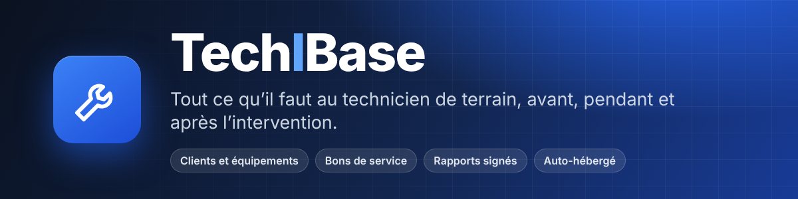
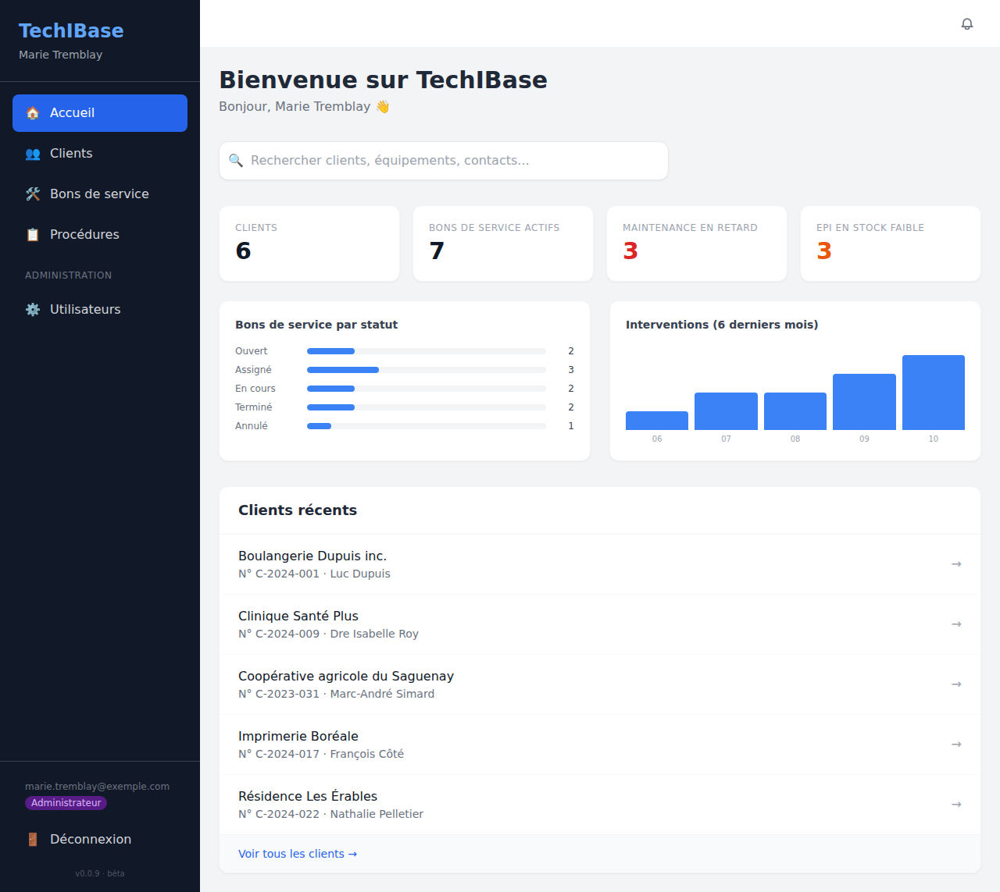

# Wiki TechIBase

**TechIBase** centralise tout ce dont un technicien de terrain a besoin avant, pendant et après une intervention : fiches clients, équipements, procédures, mots de passe, contacts, EPI, journal, documents et bons de service. Il est **open source**, **auto-hébergeable** et s'installe avec Docker en une commande.

> **État : bêta (versions `0.0.x`).** Fiches clients, bons de service, maintenance préventive avec cycles et rappels, vue mobile « Ma journée », rapports d'intervention signés (PDF), coffre-fort de mots de passe chiffré, journal d'audit, administration (mises à jour en un clic facultatives), connexion SSO facultative, mode clair et sombre. À essayer avec des données fictives avant de lui confier des données sensibles : voir [Versions et mises à jour](versions-et-mises-a-jour.md).

> Toutes les captures de ce wiki montrent des **données fictives** (entreprises, personnes, numéros `555-01xx` et mots de passe inventés).

## Par où commencer

| Je veux… | Page |
|---|---|
| installer TechIBase sur mon serveur | [Installation](installation.md) |
| me connecter, créer le premier compte, me repérer | [Premiers pas](premiers-pas.md) |
| consulter ou remplir la fiche d'un client | [La fiche client](fiche-client.md) |
| planifier et suivre des interventions | [Bons de service](bons-de-service.md) |
| voir mes interventions du jour depuis mon téléphone | [Ma journée](ma-journee.md) |
| faire signer un rapport au client et produire un PDF | [Rapports d'intervention](rapports-d-intervention.md) |
| ne plus oublier une maintenance ni un EPI expiré | [Maintenance et rappels](maintenance-et-rappels.md) |
| retrouver une information vite, être alerté | [Recherche et notifications](recherche-et-notifications.md) |
| gérer les comptes, le SSO, les courriels | [Administration](administration.md) |
| savoir qui a fait quoi | [Journal d'audit](journal-d-audit.md) |
| mettre à jour, choisir une version, revenir en arrière | [Versions et mises à jour](versions-et-mises-a-jour.md) |
| comprendre un message d'erreur | [Dépannage](depannage.md) |

## Pour installer et exploiter
- [Installation](installation.md) — une commande, un seul conteneur, port `26591`, HTTPS, sauvegarde et restauration
- [Administration](administration.md) — version et mises à jour, santé du serveur, comptes, SSO, courriels, planificateur
- [Journal d'audit](journal-d-audit.md) — connexions, actions sensibles, accès au coffre-fort, export CSV, conservation
- [Versions et mises à jour](versions-et-mises-a-jour.md) — numéros de version, images Docker, mise à jour et retour arrière
- [Dépannage](depannage.md) — l'installation, l'application, la vérification de bout en bout
- [FAQ](FAQ.md) — port, emplacement des données, sauvegarde, mise à jour, mot de passe administrateur oublié

## Pour utiliser l'application
- [Premiers pas](premiers-pas.md) — connexion, premier compte (administrateur), barre latérale, tableau de bord
- [La fiche client](fiche-client.md) — équipements, bons de service, procédures, mots de passe, contacts, EPI, journal, documents
- [Bons de service](bons-de-service.md) — le tableau, l'assignation, les bons préventifs automatiques
- [Ma journée](ma-journee.md) — la vue téléphone du technicien : démarrer, terminer, appeler, ouvrir la carte, noter
- [Rapports d'intervention](rapports-d-intervention.md) — travaux, pièces, temps, signature du client, PDF
- [Maintenance et rappels](maintenance-et-rappels.md) — cycles, report automatique, alertes de l'accueil, EPI expirés
- [Recherche et notifications](recherche-et-notifications.md) — recherche globale, cloche, courriels
- [Mode sombre](mode-sombre.md) — thème clair, sombre ou automatique

## Pour comprendre le projet
- [README du dépôt](../README.md) — architecture, variables d'environnement, tests, développement local sans Docker
- [Journal des versions](../CHANGELOG.md) — ce qui change à chaque version

## En bref

- **Application web** (React) servie par nginx, **API** Node.js/Express, base **PostgreSQL**. Une nouvelle installation tient dans **un seul conteneur** Docker (application, API, planificateur et base de données) et un seul volume de données.
- **Utilisable sur téléphone** : la barre latérale devient un menu, les pages s'adaptent à l'écran, et la page [Ma journée](ma-journee.md) est pensée pour le terrain.
- **Les mots de passe des clients sont chiffrés** dans la base et masqués à l'écran tant que vous ne cliquez pas sur « Afficher » ; chaque accès est inscrit au [journal d'audit](journal-d-audit.md).
- **Un seul fichier de configuration** : `.env`. Les données vivent dans le volume Docker de l'installation, à sauvegarder (voir la [FAQ](FAQ.md)).

## Avertissement

TechIBase est en bêta : n'y mettez pas de données dont la perte serait grave sans avoir testé votre [sauvegarde](installation.md#sauvegarde-et-restauration). Ne l'exposez pas sur Internet sans restreindre l'accès (voir [Administration](administration.md#lauto-inscription)).
