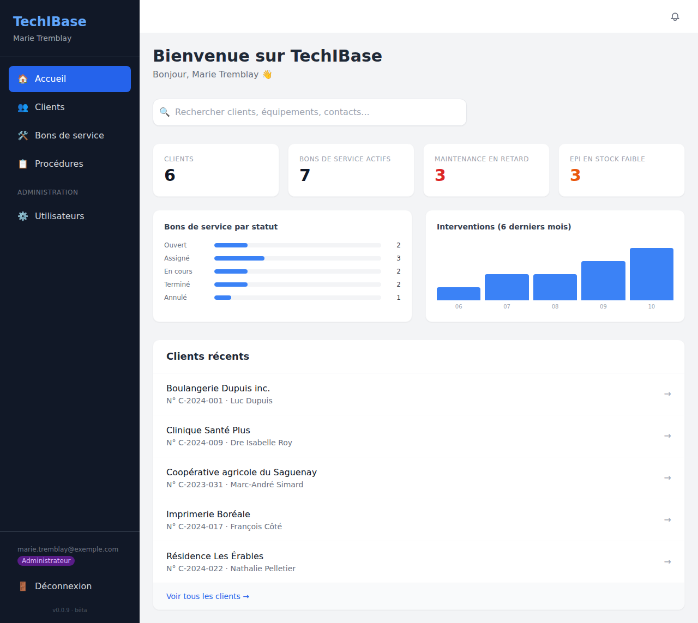

# Wiki TechIBase

**TechIBase** centralise tout ce dont un technicien de terrain a besoin avant, pendant et après une intervention : fiches clients, équipements, procédures, mots de passe, contacts, EPI, journal, documents et bons de service.

> Toutes les captures de ce wiki montrent des **données fictives** (entreprises, personnes, numéros `555-01xx` et mots de passe inventés).

## Par où commencer

| Je veux… | Page |
|---|---|
| installer TechIBase sur mon serveur | [Installation](installation.md) |
| me connecter, créer le premier compte, me repérer | [Premiers pas](premiers-pas.md) |
| consulter ou remplir la fiche d'un client | [La fiche client](fiche-client.md) |
| planifier et suivre des interventions | [Bons de service](bons-de-service.md) |
| retrouver une information vite, être alerté | [Recherche et notifications](recherche-et-notifications.md) |
| gérer les comptes, le SSO, les courriels | [Administration](administration.md) |
| mettre à jour, choisir une version, revenir en arrière | [Versions et mises à jour](versions-et-mises-a-jour.md) |
| comprendre un message d'erreur | [Dépannage](depannage.md) |

## En bref

- **Application web** (React) servie par nginx, **API** Node.js/Express, base **PostgreSQL**. Tout tourne dans des conteneurs Docker : base de données, API, planificateur des tâches quotidiennes et application web.
- **Utilisable sur téléphone** : la barre latérale devient un menu, les pages s'adaptent à l'écran.
- **Les mots de passe des clients sont chiffrés** dans la base et masqués à l'écran tant que vous ne cliquez pas sur « Afficher ».
- **Un seul fichier de configuration** : `.env`. Les données vivent dans deux volumes Docker (`db_data` et `uploads`) qu'il faut sauvegarder.
- Le projet est en **bêta** (versions `0.0.x`) : voir [Versions et mises à jour](versions-et-mises-a-jour.md).

## Pour les développeurs

Le [README du dépôt](../README.md) décrit l'architecture, les variables d'environnement, les tests et le développement local sans Docker. Le [CHANGELOG](../CHANGELOG.md) liste ce qui change à chaque version.
