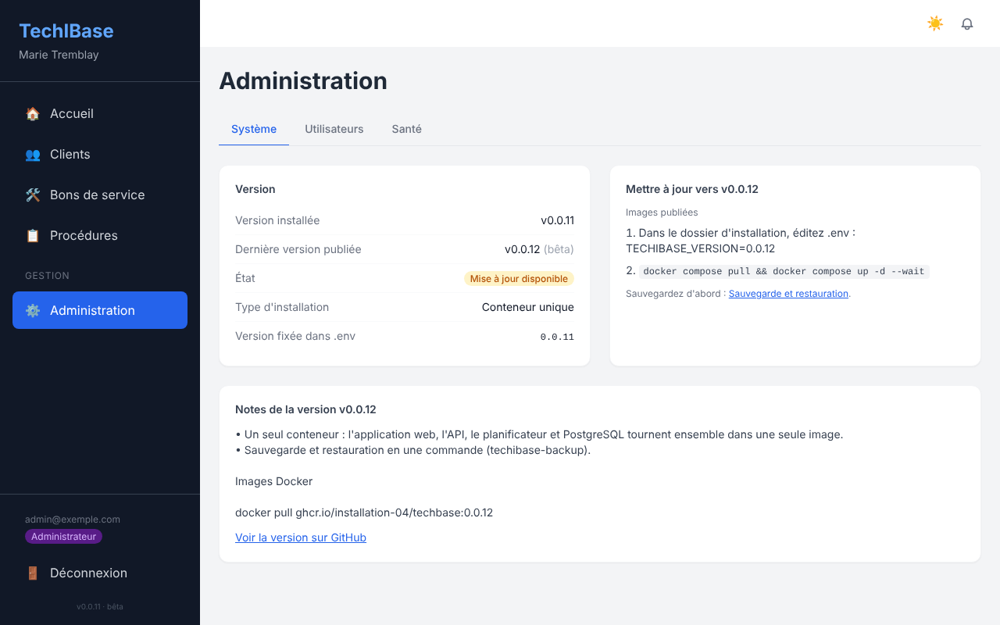
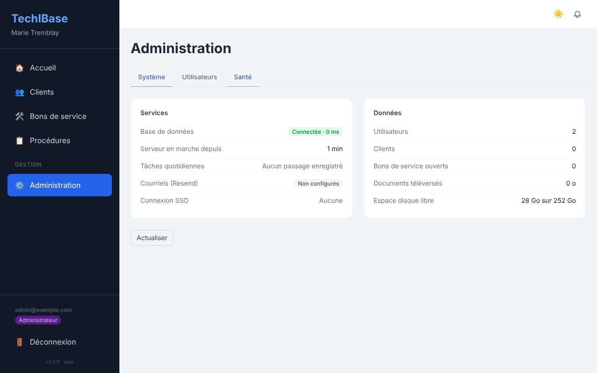
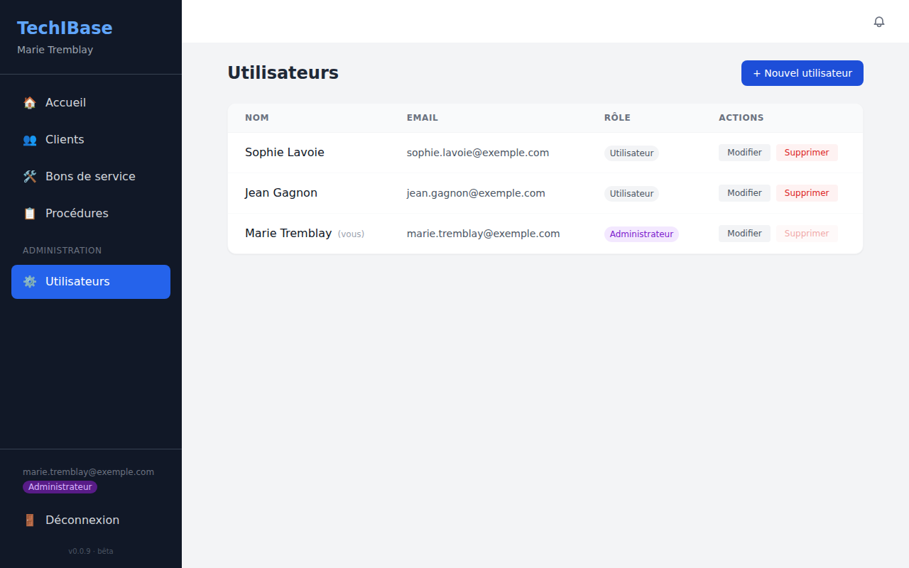

# Administration

Les administrateurs ont une entrée **Administration** dans le menu, avec trois onglets : **Système** (version et mises à jour), **Utilisateurs** (les comptes) et **Santé** (l'état du serveur).

## Système : version et mises à jour

- La **version installée**, la **dernière version publiée** sur GitHub et un état : « À jour », « Mise à jour disponible » ou, si le serveur ne peut pas joindre GitHub, « Version la plus récente inconnue ».
- Le **type d'installation** (conteneur unique, quatre conteneurs, code source ou Netlify) et, pour une installation par images publiées, la version fixée dans `.env`.
- Les **notes de la version** la plus récente et les **commandes à lancer** pour mettre à jour, adaptées à votre type d'installation (voir aussi [Versions et mises à jour](versions-et-mises-a-jour.md)).

La vérification interroge l'API publique de GitHub depuis le serveur, au plus une fois par heure, et n'envoie aucune information sur votre installation. Pour la désactiver (serveur sans accès Internet), mettez `UPDATE_CHECK=false` dans `.env`.

### Mise à jour en un clic (facultatif)

Si le **service de mise à jour** est activé, l'onglet Système affiche un bouton **Mettre à jour vers vX.Y.Z**. Il faut une installation par les **images publiées** (commande rapide ou paquet de release, avec `TECHIBASE_VERSION` fixée à un numéro précis dans `.env`).

**Ce qui se passe quand vous cliquez** (vous devez retaper **votre mot de passe**) :

1. une **sauvegarde** de la base de données et des documents est écrite dans le dossier `backups/` de l'installation ;
2. `TECHIBASE_VERSION` est changée dans `.env` (l'ancien fichier est gardé en `.env.bak`), les nouvelles images sont téléchargées et l'application est recréée (environ une minute d'indisponibilité) ;
3. le service vérifie que la nouvelle version répond ;
4. **si elle ne démarre pas, l'ancienne version est remise automatiquement** et l'échec est expliqué. Le bouton **Revenir à vX.Y.Z** permet aussi un retour manuel (les données ne sont pas restaurées : voir [Sauvegarde et restauration](installation.md#sauvegarde-et-restauration) si une version a modifié la base).

Chaque demande et son résultat sont inscrits dans un journal (`audit_log`) avec le nom de l'administrateur.

**Activer le service** : `./install.sh --with-updater` dans le dossier d'installation (relançable, ne touche pas au reste du `.env`), puis `docker compose up -d`. À la main : ajoutez `docker-compose.updater.yml` à `COMPOSE_FILE`, puis définissez dans `.env` `INSTALL_DIR` (chemin absolu du dossier) et `UPDATER_TOKEN` (32 caractères aléatoires ou plus).

> ⚠️ **À savoir avant de l'activer.** Ce service reçoit l'accès au **socket Docker**, ce qui équivaut à un accès administrateur (root) sur le serveur : celui qui pourrait lui parler pourrait lancer n'importe quel conteneur. Il est donc isolé : conteneur à part (l'application n'a jamais le socket), joignable seulement sur le réseau privé de Docker avec un secret, trois actions fixes seulement (état, mise à jour vers une version **publiée**, retour arrière), et l'application ne le sollicite que pour un administrateur qui vient de retaper son mot de passe. Si vous préférez garder la main, ne l'activez pas : la section « Mettre à jour » indique les deux commandes à lancer vous-même. Le service ne se met pas à jour lui-même ; après une mise à jour, `docker compose pull updater && docker compose up -d updater` applique sa nouvelle version.

## Santé : l'état du serveur

La base de données est-elle joignable (et en combien de temps), depuis quand le serveur tourne, quand les tâches quotidiennes ont passé pour la dernière fois, si les courriels et la connexion SSO sont configurés, le nombre d'utilisateurs, de clients et de bons de service ouverts, la taille des documents téléversés et l'espace disque libre.

## Les comptes

## Les comptes

Il existe deux rôles :

| Rôle | Peut |
|---|---|
| **Administrateur** | tout ce que fait un utilisateur, plus : gérer les comptes (onglet **Utilisateurs**), supprimer des clients, recevoir le résumé quotidien par courriel |
| **Utilisateur** | consulter et modifier les données des clients, les bons de service, les procédures, le coffre-fort et les documents |

Depuis l'onglet **Utilisateurs** (visible aux administrateurs seulement) :

- **+ Nouvel utilisateur** crée un compte : nom, courriel, mot de passe (8 caractères minimum) et rôle.
- **Modifier** change le nom, le courriel ou le rôle. Pour **réinitialiser le mot de passe** d'un utilisateur, saisissez-en un nouveau dans le formulaire ; laissé vide, le mot de passe actuel est conservé.
- **Supprimer** retire un compte. Vous ne pouvez pas supprimer le vôtre.

> Prévoyez **au moins deux administrateurs** : il n'y a pas de procédure « mot de passe oublié » en libre-service, c'est un autre administrateur qui réinitialise le mot de passe.

### L'auto-inscription

N'importe qui connaissant l'adresse de l'application peut s'y créer un compte « Utilisateur ». Comme TechIBase stocke des identifiants de clients, **n'exposez pas l'application sur Internet sans restreindre l'accès** : VPN, pare-feu ou liste d'adresses autorisées devant le serveur. Il n'existe pas encore d'option pour fermer l'inscription.

## La connexion SSO (facultatif)

Les boutons **Google** et **Microsoft 365** de l'écran de connexion n'apparaissent que si les variables correspondantes sont définies. Dans les deux cas, `PUBLIC_URL` doit contenir l'adresse publique de l'application (`https://app.exemple.com`).

**Google** : dans la [console Google Cloud](https://console.cloud.google.com/), créez un identifiant OAuth de type *Application Web* avec l'URI de redirection `https://<votre-domaine>/api/auth/google/callback`, puis renseignez `GOOGLE_CLIENT_ID` et `GOOGLE_CLIENT_SECRET`.

**Microsoft 365** : dans le [portail Azure](https://portal.azure.com/) (Microsoft Entra ID → inscriptions d'applications), créez une application *Web* avec l'URI `https://<votre-domaine>/api/auth/microsoft/callback` et un secret client, puis renseignez `MICROSOFT_CLIENT_ID` et `MICROSOFT_CLIENT_SECRET`. Sans `MICROSOFT_TENANT_ID`, tout compte Microsoft est accepté ; indiquez l'identifiant de votre organisation pour la restreindre.

Un compte SSO est créé à la première connexion. **Le tout premier compte créé, SSO inclus, devient administrateur.** Après une modification du `.env` : `docker compose up -d`.

## Les courriels

Renseignez `RESEND_API_KEY` (clé d'un compte [Resend](https://resend.com)) et, si besoin, `EMAIL_FROM` (par exemple `TechIBase <alertes@exemple.com>`). Voir [Recherche et notifications](recherche-et-notifications.md) pour ce qui est envoyé.

## L'intégration Acumatica (facultatif)

Chaque utilisateur connecte **son propre** compte Acumatica depuis l'onglet **Intégrations** d'une fiche client, puis synchronise ses clients, à la demande, vers les *Customers* Acumatica. C'est ce qui permet à plusieurs entreprises de partager une installation sans mélanger leurs ERP.

Pour un déploiement mono-entreprise, des identifiants partagés peuvent servir de repli, via `ACUMATICA_BASE_URL`, `ACUMATICA_USERNAME`, `ACUMATICA_PASSWORD` et `ACUMATICA_COMPANY` dans le `.env`.

## Le planificateur

Le conteneur `scheduler` exécute chaque jour la génération des [bons de service préventifs](bons-de-service.md) et l'envoi du résumé aux administrateurs.

| Variable | Rôle |
|---|---|
| `SCHEDULER_TIME` | Heure du passage, `HH:MM`, 24 h (défaut `06:00`) |
| `TZ` | Fuseau horaire de l'heure ci-dessus (`America/Toronto`…) |
| `RUN_ON_START` | `true` pour exécuter aussi les tâches à chaque démarrage du conteneur |

`docker compose logs scheduler` indique la prochaine exécution. Pour déclencher tout de suite : `docker compose exec scheduler node src/scheduler.js --once` (sans risque : relancer ne crée aucun doublon).

## Sécurité : l'essentiel

- **Conservez le `JWT_SECRET`** et incluez le `.env` dans vos sauvegardes : il chiffre le coffre-fort de mots de passe. Le changer rend les mots de passe stockés illisibles.
- Seul le port de l'application web est publié par l'hôte ; l'API et la base ne sont pas accessibles de l'extérieur.
- Utilisez [HTTPS](installation.md#https-avec-un-nom-de-domaine) dès que l'application sort de votre réseau.
- Les fichiers téléversés qui pourraient exécuter du code dans le navigateur (HTML, SVG…) ne s'affichent jamais : ils se téléchargent.
- Les mots de passe du coffre-fort apparaissent masqués ; tous les utilisateurs connectés peuvent toutefois les afficher. Créez des comptes seulement pour les personnes qui doivent y avoir accès.
- Sauvegardez régulièrement : [Installation → Sauvegarde et restauration](installation.md#sauvegarde-et-restauration).
