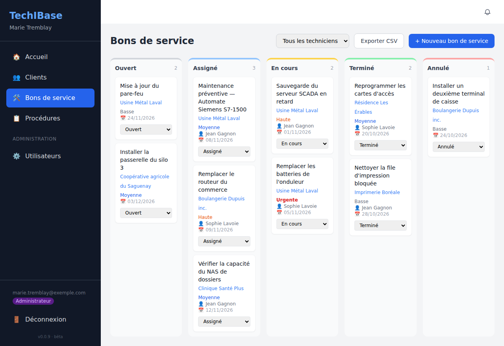
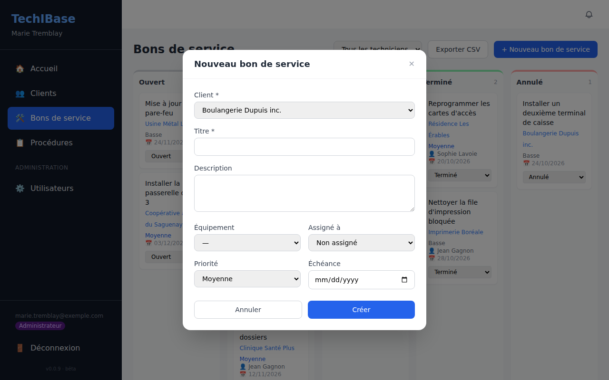

# Bons de service

Un **bon de service** (BS) est une intervention à planifier et à suivre : quoi, chez quel client, sur quel équipement, par quel technicien, pour quand.

## Le tableau

**Bons de service** dans la barre latérale ouvre le tableau de toutes les interventions, en colonnes par statut.

| Statut | Sens |
|---|---|
| **Ouvert** | À faire, pas encore assigné |
| **Assigné** | Confié à un technicien |
| **En cours** | Intervention commencée |
| **Terminé** | Fait |
| **Annulé** | Abandonné |

Sur chaque carte : le titre, le client (lien vers sa fiche), la priorité (**Basse**, **Moyenne**, **Haute** ou **Urgente**), le technicien, l'échéance, une liste déroulante pour **changer le statut** d'un clic et le bouton **Rapport d'intervention**, visible de l'administrateur, du technicien assigné et du créateur du bon (voir plus bas).

En haut du tableau :

- **Tous les techniciens** : filtre le tableau sur un technicien.
- **Exporter CSV** : télécharge les bons affichés (titre, client, équipement, statut, priorité, technicien, échéance) dans un fichier qui s'ouvre dans un tableur.
- **+ Nouveau bon de service** : crée un bon.

## Créer un bon

Choisissez le **client** et donnez un **titre** ; le reste est facultatif : description, équipement concerné, technicien assigné, priorité et échéance. Vous pouvez aussi créer un bon depuis l'onglet **Bons de service** de la fiche d'un client.

## Assigner un bon : le technicien est prévenu

Dès qu'un bon est **assigné** à un technicien, celui-ci reçoit une **notification** dans l'application (la cloche 🔔) et, si l'envoi de courriels est configuré, un **courriel**. Voir [Recherche et notifications](recherche-et-notifications.md).

## Sur le terrain : Ma journée et le rapport d'intervention

- Le technicien retrouve ses bons du jour sur la page **[Ma journée](ma-journee.md)**, pensée pour le téléphone : **Démarrer**, **Terminer**, appel du client, carte, note rapide dans le journal.
- Depuis le tableau, le bouton **Rapport d'intervention** ouvre le [rapport](rapports-d-intervention.md) du bon : travaux, pièces, temps passé, observations, **signature du client à l'écran** et **PDF** à télécharger ou à joindre aux documents du client.
- Les changements de statut faits depuis Ma journée sont inscrits au [journal d'audit](journal-d-audit.md).

## Bons de maintenance préventive automatiques

Chaque jour, le **planificateur** crée un bon de service pour tout équipement dont la **prochaine maintenance** tombe dans les **7 prochains jours** (ou est déjà dépassée). Le titre est de la forme « Maintenance préventive — *nom de l'équipement* ».

- Un seul bon est créé **par date de maintenance** : un bon terminé ou annulé n'est pas recréé le lendemain, et relancer le planificateur ne crée aucun doublon.
- Sous Docker, c'est le conteneur `scheduler` qui s'en charge, à l'heure `SCHEDULER_TIME` (06:00 par défaut) dans le fuseau `TZ`.
- Pour le déclencher tout de suite : `docker compose exec scheduler node src/scheduler.js --once`.
- Quand le bon est **terminé**, la dernière maintenance de l'équipement prend la date du jour et, si l'équipement a un **cycle de maintenance**, la prochaine est reportée d'autant : voir [Maintenance et rappels](maintenance-et-rappels.md). Sans cycle, la date de prochaine maintenance n'est pas décalée : renseignez-la à la main dans l'onglet Équipements pour planifier la suivante.

Chaque matin, les administrateurs reçoivent aussi des **rappels** dans l'application et, si les courriels sont configurés, un **résumé** : maintenance en retard ou à venir, EPI en stock faible ou expirés. Voir [Maintenance et rappels](maintenance-et-rappels.md#les-rappels).
