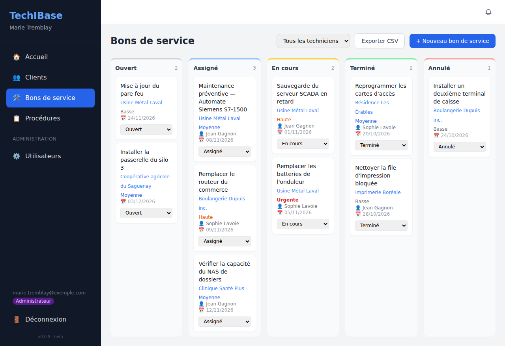
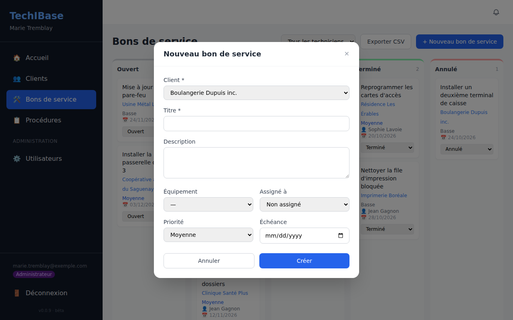

# Bons de service

Un **bon de service** (BS) est une intervention à planifier et à suivre : quoi, chez quel client, sur quel équipement, par quel technicien, pour quand.

## Le tableau

**Bons de service** dans la barre latérale ouvre le tableau de toutes les interventions, en colonnes par statut.

| Statut | Sens |
|---|---|
| **Ouvert** | À faire, pas encore assigné |
| **Assigné** | Confié à un technicien |
| **En cours** | Intervention commencée |
| **Terminé** | Fait |
| **Annulé** | Abandonné |

Sur chaque carte : le titre, le client (lien vers sa fiche), la priorité (**Basse**, **Moyenne**, **Haute** ou **Urgente**), le technicien, l'échéance et une liste déroulante pour **changer le statut** d'un clic.

En haut du tableau :

- **Tous les techniciens** : filtre le tableau sur un technicien.
- **Exporter CSV** : télécharge les bons affichés (titre, client, équipement, statut, priorité, technicien, échéance) dans un fichier qui s'ouvre dans un tableur.
- **+ Nouveau bon de service** : crée un bon.

## Créer un bon

Choisissez le **client** et donnez un **titre** ; le reste est facultatif : description, équipement concerné, technicien assigné, priorité et échéance. Vous pouvez aussi créer un bon depuis l'onglet **Bons de service** de la fiche d'un client.

## Assigner un bon : le technicien est prévenu

Dès qu'un bon est **assigné** à un technicien, celui-ci reçoit une **notification** dans l'application (la cloche 🔔) et, si l'envoi de courriels est configuré, un **courriel**. Voir [Recherche et notifications](recherche-et-notifications.md).

## Bons de maintenance préventive automatiques

Chaque jour, le **planificateur** crée un bon de service pour tout équipement dont la **prochaine maintenance** tombe dans les **7 prochains jours** (ou est déjà dépassée). Le titre est de la forme « Maintenance préventive — *nom de l'équipement* ».

- Un seul bon est créé **par date de maintenance** : un bon terminé ou annulé n'est pas recréé le lendemain, et relancer le planificateur ne crée aucun doublon.
- Sous Docker, c'est le conteneur `scheduler` qui s'en charge, à l'heure `SCHEDULER_TIME` (06:00 par défaut) dans le fuseau `TZ`.
- Pour le déclencher tout de suite : `docker compose exec scheduler node src/scheduler.js --once`.
- TechIBase **ne décale pas** la date de prochaine maintenance quand un bon est terminé : mettez à jour l'équipement (onglet Équipements) pour planifier la suivante.

Chaque matin, si les courriels sont configurés, les administrateurs reçoivent aussi un **résumé** : maintenance en retard et EPI en stock faible.
