# La fiche client

## La liste des clients

**Clients** dans la barre latérale ouvre la liste. Le champ de recherche filtre par nom, numéro de contrat ou responsable. Le bouton **+ Nouveau** crée un client.

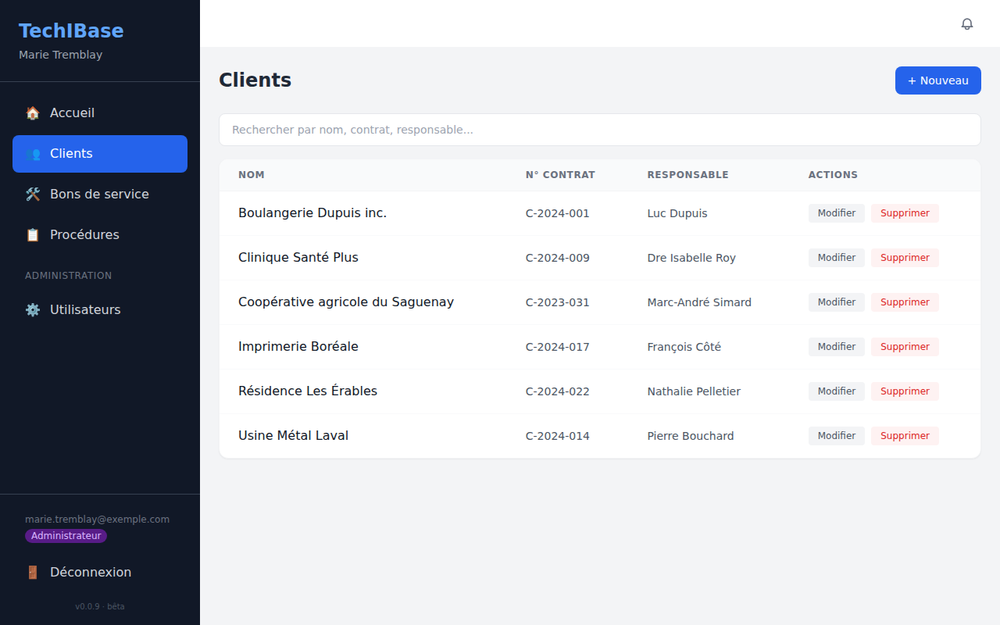

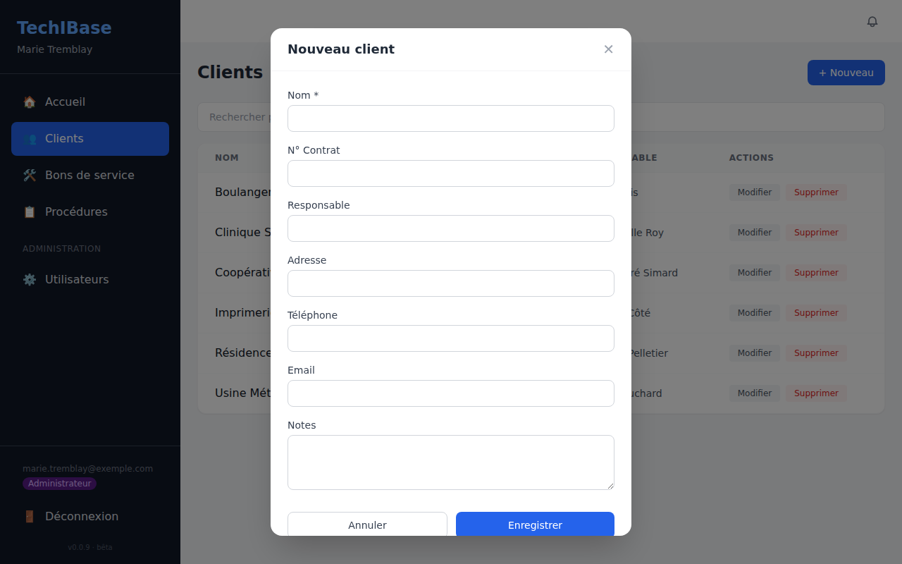

Seul le **nom** est obligatoire. Les autres champs : numéro de contrat, responsable, adresse, téléphone, courriel et notes (par exemple « Accès par la porte 3, casque obligatoire »). Supprimer un client est réservé aux administrateurs.

## Les onglets de la fiche

Cliquer sur un client ouvre sa fiche : les informations générales en haut (bouton **Modifier**), puis neuf onglets. Chaque onglet fonctionne de la même façon : **+ Ajouter** pour créer une entrée, **Modifier** et **Supprimer** sur chaque ligne.

### Équipements

L'inventaire du site : serveurs, automates, écrans, réseau, onduleurs…

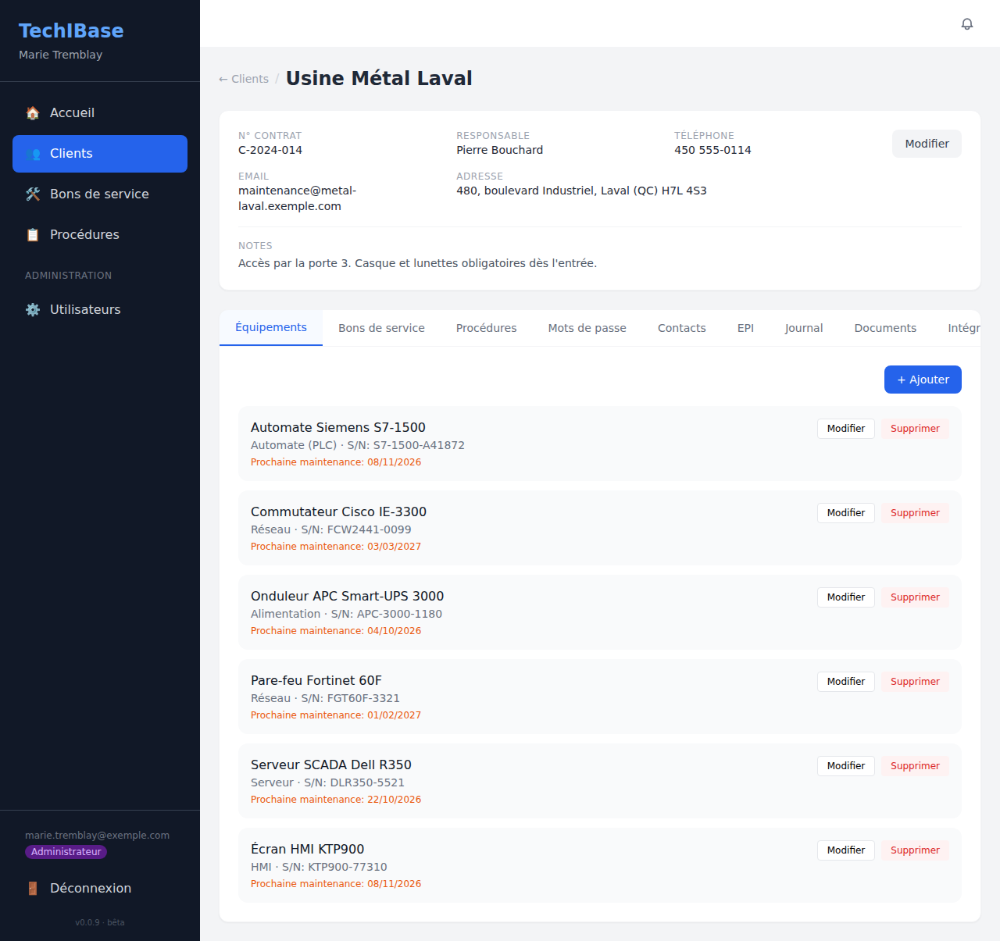

Pour chaque équipement : nom, type, numéro de série, dates d'installation, de dernière et de prochaine maintenance, statut (**Actif**, **Inactif** ou **En maintenance**) et notes. La **prochaine maintenance** apparaît en orange sous le nom.

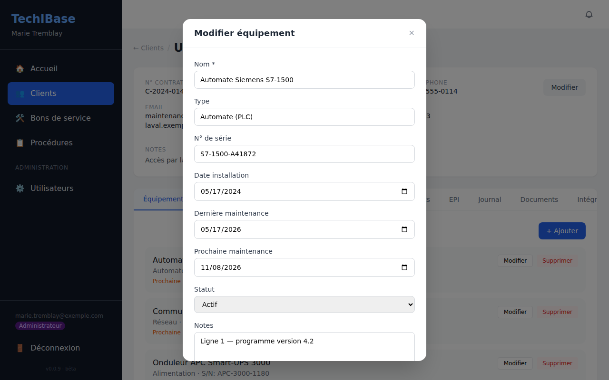

> La date de prochaine maintenance alimente le tableau de bord (maintenance en retard) et la **génération automatique de bons de service** : voir [Bons de service](bons-de-service.md).

### Bons de service

Les interventions de ce client, avec leur statut, leur priorité, le technicien assigné et l'échéance. Même contenu que le tableau global, filtré sur le client.

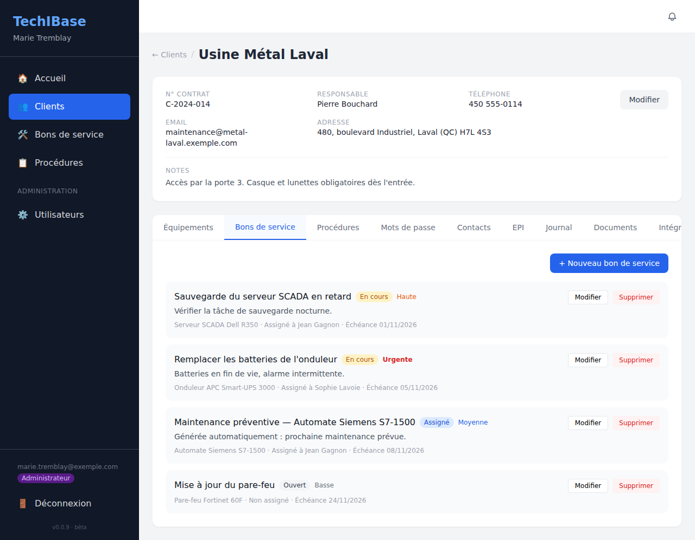

### Procédures

Les étapes à suivre pour intervenir chez ce client, de type **Présentiel** (sur place) ou **Distanciel** (à distance) : connexion VPN, redémarrage d'une ligne, remplacement d'une pièce…

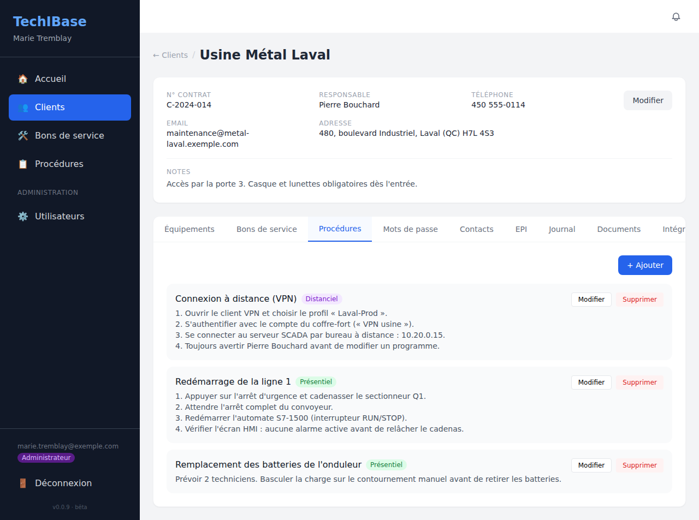

La page **Procédures** de la barre latérale rassemble celles de tous les clients.

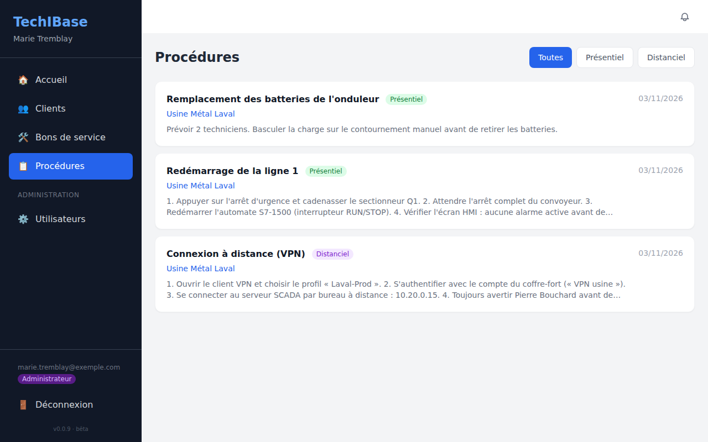

### Mots de passe

Le coffre-fort du client : un libellé, un nom d'utilisateur, un mot de passe, une adresse et des notes. Les mots de passe sont **chiffrés dans la base** et **masqués** à l'écran : cliquez sur **Afficher** pour en voir un.

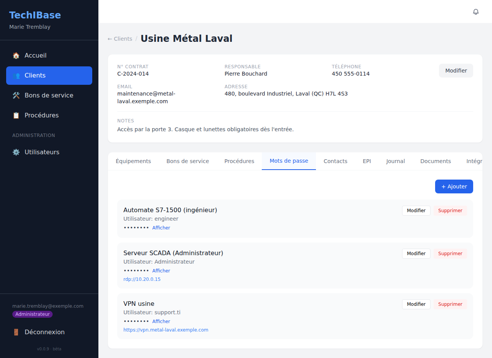

> Tous les utilisateurs connectés voient le coffre-fort de tous les clients. Limitez donc les comptes, et gardez le `JWT_SECRET` : sans lui, les mots de passe chiffrés deviennent illisibles (voir [Administration](administration.md)).

### Contacts

Les personnes à joindre chez le client : nom, fonction, téléphone, courriel, notes.

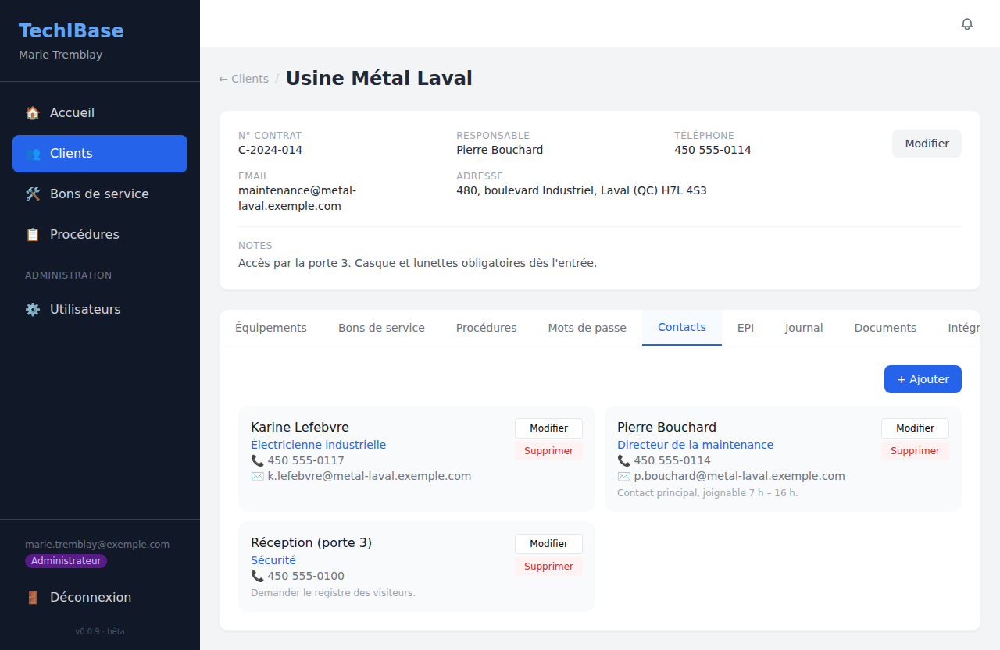

### EPI

Les équipements de protection individuelle exigés sur le site, avec la quantité, l'emplacement et la **date d'expiration** (en orange). Une quantité de **2 ou moins** compte dans « EPI en stock faible » du tableau de bord.

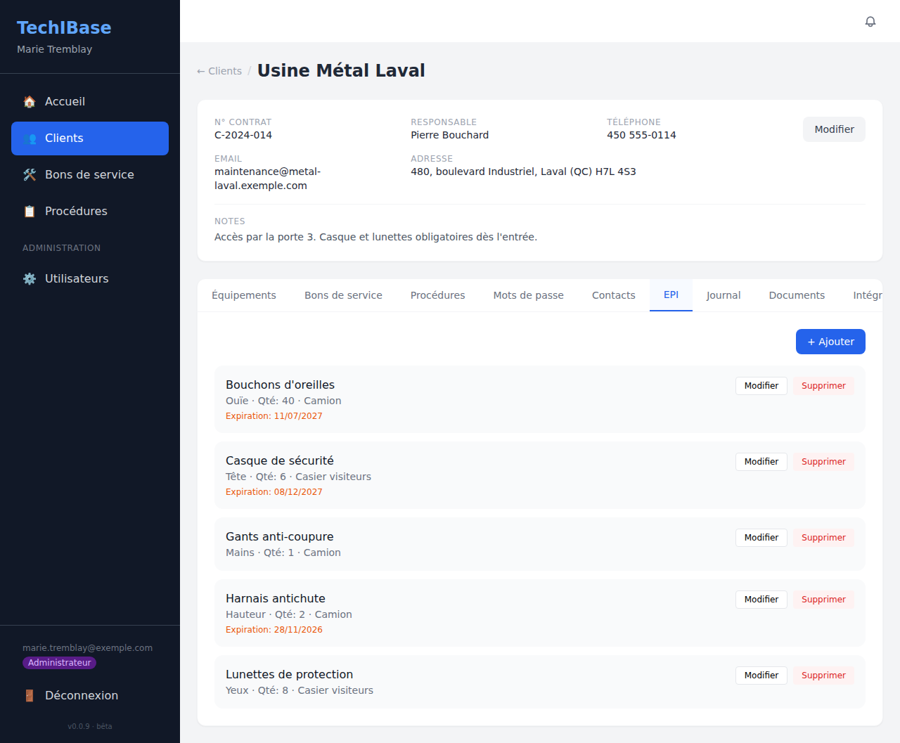

### Journal

L'historique des interventions : chaque entrée a un titre, une date et heure, un contenu et un type : **Note**, **Intervention** ou **Incident**. Les entrées de type Intervention alimentent le graphique du tableau de bord.

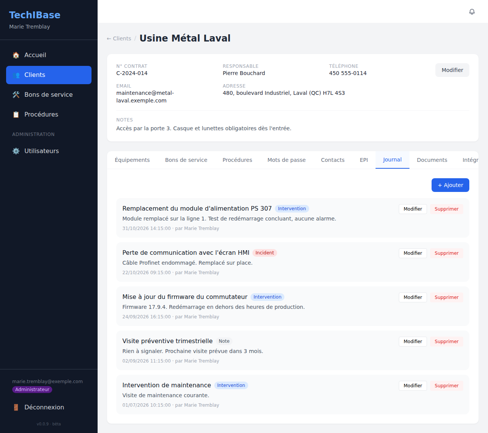

### Documents

La bibliothèque de fichiers du client : schémas, manuels, photos, notes. **+ Téléverser** ajoute un fichier (jusqu'à 50 Mo).

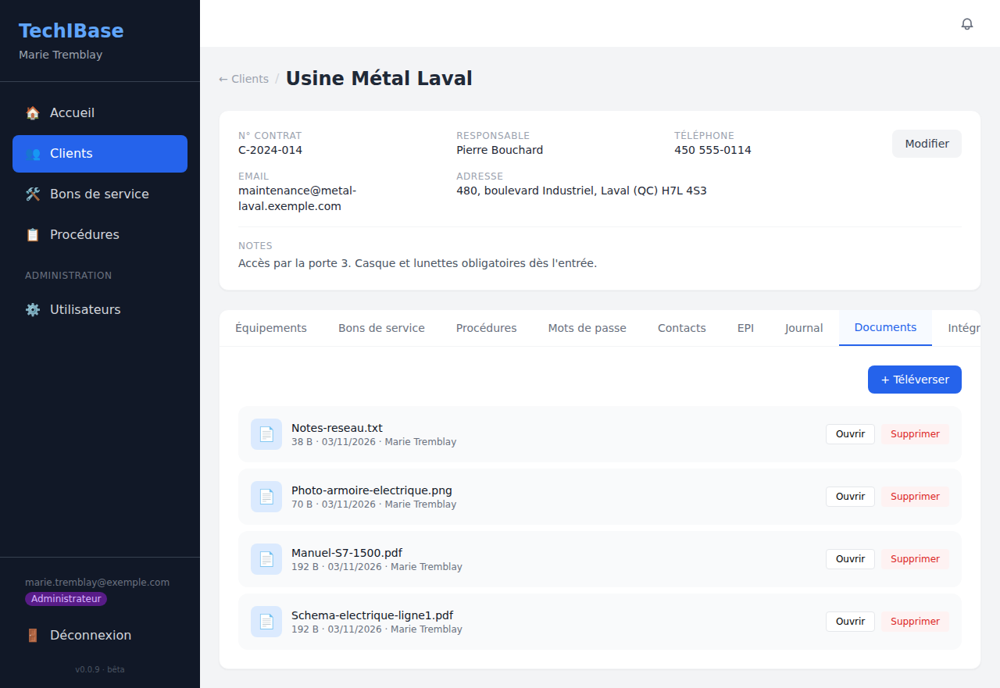

Pour des raisons de sécurité, **Ouvrir** n'affiche dans le navigateur que les types sûrs : **PDF, images (PNG, JPEG, GIF, WebP) et texte brut**. Tout autre type de fichier (HTML, SVG, CSV, archives…) est **téléchargé** au lieu d'être affiché.

### Intégrations

Chaque utilisateur peut connecter **son propre** compte ERP **Acumatica** (adresse de l'instance, identifiants, société) et synchroniser les clients, à la demande, avec un bouton par fiche.

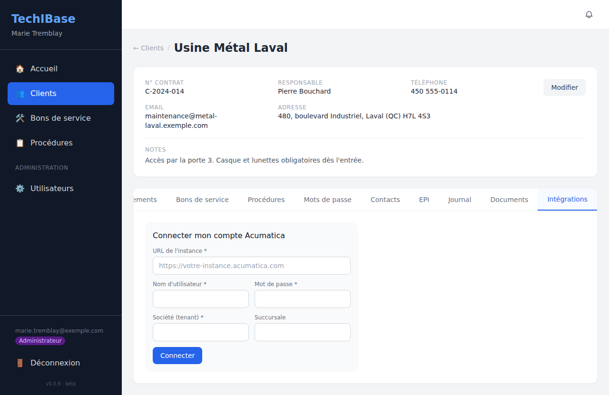

La synchronisation n'est jamais automatique, pour qu'aucune donnée ne soit écrasée par surprise. Détails et variables : [Administration](administration.md).
