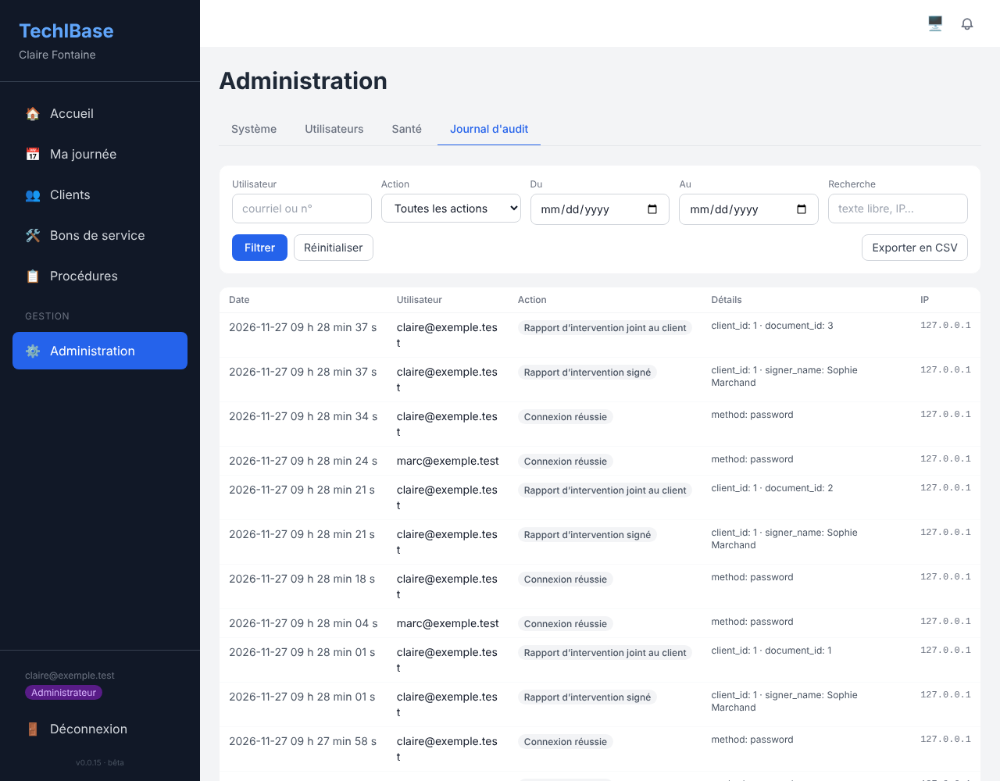
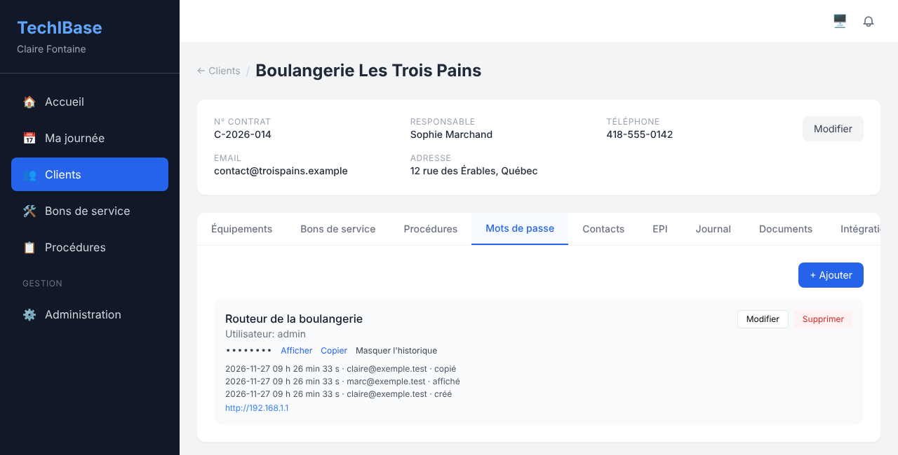

# Journal d'audit

Le **journal d'audit** répond à la question « qui a fait quoi, et quand ? » : connexions, gestion des comptes, accès aux mots de passe du coffre-fort, documents, mises à jour. Il est réservé aux **administrateurs** : onglet **Journal d'audit** de l'entrée **Administration** (voir [Administration](administration.md)).

Les entrées sont classées de la plus récente à la plus ancienne, **50 par page** (boutons **Précédent** / **Suivant** et nombre total en bas du tableau). Chaque ligne indique :

| Colonne | Contenu |
|---|---|
| **Date** | Date et heure de l'événement |
| **Utilisateur** | Le courriel de la personne ; « Système » pour une action automatique (par exemple la purge quotidienne) |
| **Action** | Une étiquette en clair, de couleur : **rouge** pour les échecs de connexion et les suppressions, **orange** pour les accès aux mots de passe, les changements de rôle ou de mot de passe et les retours arrière, gris pour le reste |
| **Détails** | Informations utiles (méthode de connexion, libellé de l'entrée du coffre, numéro de client, etc.) |
| **IP** | L'adresse de la connexion (le navigateur utilisé s'affiche en passant la souris dessus) |

## Ce qui est enregistré

| Famille (filtre) | Actions |
|---|---|
| **Connexions** | connexion réussie ou échouée (mot de passe et SSO) |
| **Utilisateurs** | inscription, création, changement de rôle, de mot de passe ou de courriel, suppression |
| **SSO** | compte Google ou Microsoft lié à un compte existant |
| **Coffre-fort** | mot de passe **affiché** ou **copié**, entrée créée, modifiée, supprimée |
| **Intégrations** | Acumatica connecté, déconnecté, client envoyé |
| **Clients** | client créé, modifié, supprimé |
| **Documents** | document ajouté, téléchargé, supprimé |
| **Mises à jour** | mise à jour demandée, réussie, échouée, annulée ; retour arrière demandé (voir [Administration](administration.md#mise-à-jour-en-un-clic-facultatif)) |
| **Journal** | journal exporté, journal purgé |

S'y ajoutent les changements de statut d'un bon de service faits depuis [Ma journée](ma-journee.md) et, pour les [rapports d'intervention](rapports-d-intervention.md), « Rapport d'intervention signé » et « Rapport d'intervention joint au client ».

Un mot de passe n'est **jamais** enregistré, ni en clair ni chiffré : les clés de détail qui ressemblent à un secret (mot de passe, jeton, clé d'API…) sont masquées avant l'écriture. Une écriture au journal qui échoue est consignée dans les logs du serveur, mais ne fait jamais échouer l'action de la personne.

## Filtrer et exporter

Au-dessus du tableau :

- **Utilisateur** : courriel ou numéro ;
- **Action** : une famille du tableau ci-dessus ;
- **Du** / **Au** : plage de dates (le jour de fin est inclus) ;
- **Recherche** : texte libre dans l'action, le courriel, l'IP et les détails.

**Filtrer** applique, **Réinitialiser** efface. **Exporter en CSV** télécharge `journal-audit.csv` avec **les mêmes filtres** (50 000 lignes au plus). Les cellules qui commencent par `=`, `+`, `-` ou `@` sont préfixées d'une apostrophe, pour qu'un tableur ne les exécute pas comme des formules. Chaque export est lui-même inscrit au journal (« Journal exporté »).

## Le coffre-fort de mots de passe

Chaque fois qu'une personne clique sur **Afficher** ou **Copier** dans l'onglet **Mots de passe** d'une fiche client, le journal retient **qui**, **quelle entrée** (son libellé) et **quand**. Le mot de passe lui-même n'est jamais écrit.

Dans la fiche client, les administrateurs voient en plus, sous chaque entrée, un bouton **Historique** : la liste de ceux qui l'ont affichée, copiée, créée ou modifiée.

> Le journal reflète les actions faites **dans l'interface**. La liste des mots de passe d'un client est toujours transmise au navigateur (masquée à l'écran) : un accès direct à l'API n'est donc pas distingué d'une simple consultation de la liste. Voir [La fiche client](fiche-client.md).

## L'adresse IP

Elle vient de la connexion, ou de l'en-tête `X-Forwarded-For` seulement pour **un** proxy de confiance (un saut, comme pour la limitation de débit). Derrière un autre montage, vérifiez que votre proxy transmet bien l'adresse réelle du client : sinon, le journal affichera l'adresse du proxy.

## Conservation

Les tâches quotidiennes du [planificateur](administration.md#le-planificateur) suppriment les entrées de plus de **`AUDIT_RETENTION_DAYS`** jours :

| Valeur | Effet |
|---|---|
| (absente) ou `365` | Un an de conservation, **par défaut** |
| un entier positif | Cette durée, en jours |
| `0` | Tout conserver, rien n'est purgé |
| une valeur invalide | Revient à 365 |

Chaque purge laisse elle-même une entrée « Journal purgé » (nombre de lignes supprimées, ancienneté). La variable se règle dans le `.env` (`AUDIT_RETENTION_DAYS=365` figure dans le `.env.example` dont part une nouvelle installation ; sur une installation plus ancienne, ajoutez la ligne), puis `docker compose up -d`. **Exportez le journal en CSV avant de réduire la durée** si vous devez l'archiver.

## Voir aussi

- [Administration](administration.md) : les autres onglets et la gestion des comptes.
- [Installation](installation.md#réglages-env) : le tableau des variables du `.env`.
- [FAQ](FAQ.md) : réponses rapides, dont la sauvegarde du journal avec le reste des données.
