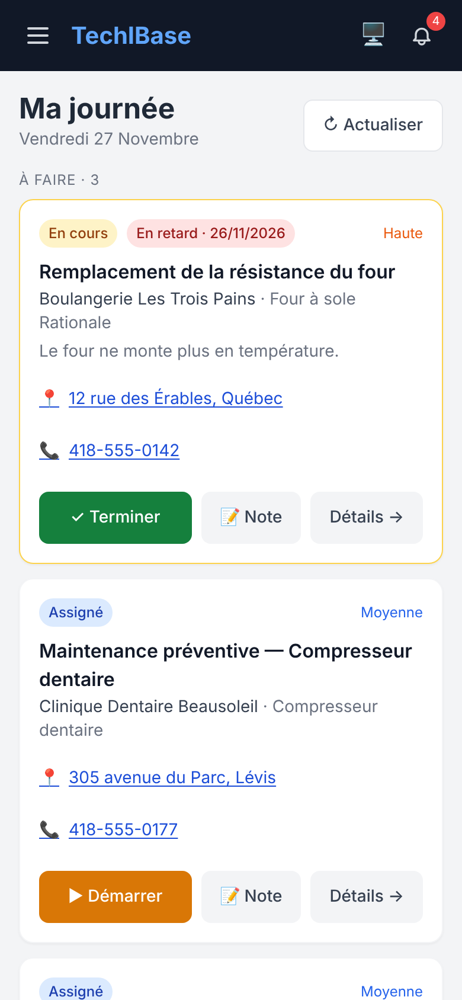

# Ma journée

**Ma journée** est la page du technicien sur le terrain : ses interventions du jour, une carte par bon de service, avec des boutons assez grands pour être touchés avec des gants. Elle s'ouvre depuis **Ma journée** dans la barre latérale (ou le menu ☰ du téléphone).

## Ce que la page affiche

Seuls **vos** bons de service, c'est-à-dire ceux qui vous sont **assignés**, apparaissent :

| Section | Contenu |
|---|---|
| **À faire** | Les bons **en cours** (toujours, même sans échéance), puis les bons **ouverts ou assignés dont l'échéance est aujourd'hui ou déjà passée** |
| **Terminés aujourd'hui** | Les bons que vous avez terminés dans la journée |

Un bon assigné **sans date d'échéance** qui n'est pas encore démarré n'apparaît donc pas ici : donnez-lui une échéance, ou démarrez-le depuis le [tableau des bons](bons-de-service.md). Les bons annulés n'apparaissent jamais.

L'ordre est : bons en cours d'abord, puis par échéance, puis par priorité (**Urgente**, **Haute**, **Moyenne**, **Basse**). Un bon dont l'échéance est passée porte l'étiquette rouge **En retard · JJ/MM/AAAA**.

La notion de « jour » est celle de **votre téléphone** (sa date et son fuseau horaire), pas celle du serveur : un bon terminé à 21 h au Québec reste dans « Terminés aujourd'hui » même si le serveur est réglé sur un autre fuseau. La page se rafraîchit toute seule quand vous revenez sur l'onglet ; **↻ Actualiser** force la mise à jour.

## Sur une carte

Chaque carte montre le statut, la priorité, le titre, le **client** et l'équipement concerné, un extrait de la description, puis :

- **l'adresse du client** : un toucher ouvre la carte (Google Maps) dans un nouvel onglet ;
- **le téléphone du client** : un toucher lance l'appel (lien `tel:`) ;
- les boutons d'action :

| Bouton | Effet |
|---|---|
| **▶ Démarrer** | Passe le bon de « Ouvert » ou « Assigné » à **En cours** |
| **✓ Terminer** | Passe le bon **En cours** à **Terminé** |
| **Rouvrir** | Remet un bon terminé **En cours** |
| **📝 Note** | Ouvre une zone de texte ; **Enregistrer la note** ajoute une entrée de type « note » au **Journal** du client, titrée « Note : *titre du bon* » (message de confirmation « Note ajoutée au journal ✓ ») |
| **Détails →** | Ouvre la fiche du client sur son onglet **Bons de service** |

Terminer un bon de maintenance préventive **reporte automatiquement** la prochaine maintenance de l'équipement : voir [Maintenance et rappels](maintenance-et-rappels.md#ce-qui-se-passe-quand-le-bon-est-terminé).

Le statut ne peut être changé que par la personne **assignée** ou par un administrateur. Le **rapport d'intervention** (travaux, pièces, signature du client) se rédige depuis le tableau des **Bons de service** : voir [Rapports d'intervention](rapports-d-intervention.md).

## Arriver directement sur Ma journée

Sur **téléphone** (écran de moins de 768 px de large), un utilisateur qui n'est **pas administrateur** est conduit à Ma journée à l'ouverture de l'application, une fois par session ; les administrateurs arrivent sur l'**Accueil**. Sur ordinateur, personne n'est redirigé : la page est une entrée comme les autres de la barre latérale.

Si rien n'est prévu, la page l'indique (« Rien de prévu pour aujourd'hui ») et renvoie vers le tableau de tous les bons de service.

## Voir aussi

- [Bons de service](bons-de-service.md) : créer, assigner et suivre les bons.
- [Recherche et notifications](recherche-et-notifications.md) : être prévenu d'une nouvelle assignation.
- [Mode sombre](mode-sombre.md) : un affichage plus reposant le soir.
