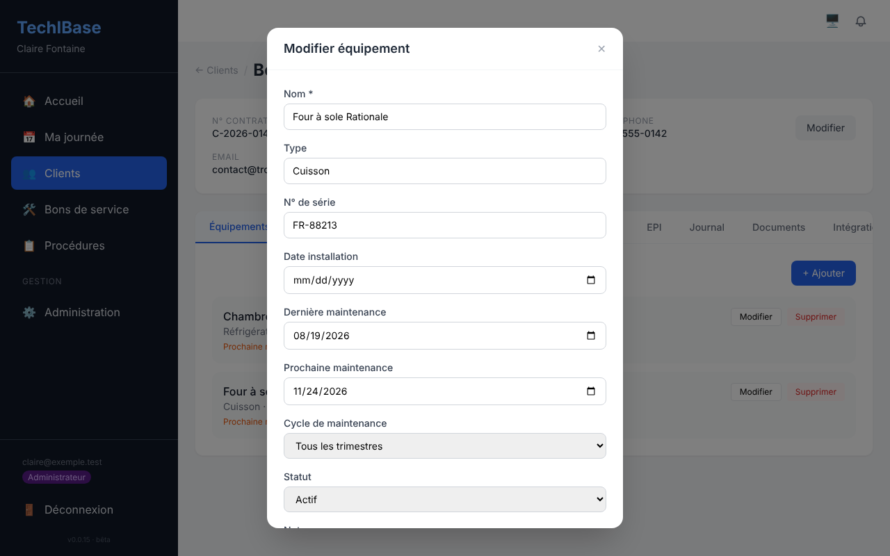
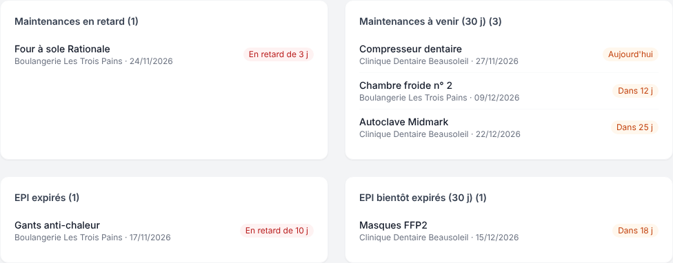

# Maintenance et rappels

TechIBase suit la maintenance préventive de chaque équipement et vous prévient avant qu'elle ne soit en retard : un **cycle** par équipement, un **report automatique** de la prochaine date quand l'intervention est terminée, des **listes d'alerte** sur l'accueil et des **rappels** envoyés chaque jour aux administrateurs.

## Le cycle de maintenance d'un équipement

Dans l'onglet **Équipements** d'une [fiche client](fiche-client.md), **Modifier** (ou **+ Ajouter**) ouvre le formulaire de l'équipement. Trois champs commandent la maintenance :

| Champ | Rôle |
|---|---|
| **Dernière maintenance** | Date de la dernière intervention. Renseignée automatiquement à la fin d'un bon de maintenance (voir plus bas) |
| **Prochaine maintenance** | Date prévue. C'est elle qui déclenche les bons préventifs, les alertes et les rappels |
| **Cycle de maintenance** | **Aucun (ponctuel)**, **Tous les mois**, **Tous les trimestres**, **Tous les semestres**, **Tous les ans** ou **Tous les 2 ans** |

Dans la liste, la ligne de l'équipement affiche « Prochaine maintenance : JJ/MM/AAAA · cycle : N mois ». Un cycle d'une autre durée (de 1 à 120 mois) peut être posé par l'API ; le formulaire le conserve et l'affiche alors « Tous les N mois ».

## Ce qui se passe quand le bon est terminé

Chaque jour, le [planificateur](administration.md#le-planificateur) crée un bon de service « Maintenance préventive — *équipement* » pour tout équipement dont la prochaine maintenance tombe dans les 7 prochains jours ou est dépassée (voir [Bons de service](bons-de-service.md#bons-de-maintenance-préventive-automatiques)).

Quand ce bon passe à **Terminé**, que ce soit depuis le tableau des bons ou depuis [Ma journée](ma-journee.md) :

1. la **dernière maintenance** de l'équipement prend la date du jour ;
2. si l'équipement a un **cycle**, la **prochaine maintenance** est reportée d'autant à partir du jour de la fin : un bon terminé le 27 novembre sur un cycle trimestriel reporte la prochaine au 27 février ;
3. sans cycle (« Aucun (ponctuel) »), seule la dernière maintenance est mise à jour ; la prochaine date reste telle quelle et aucun nouveau bon n'est créé pour elle. Renseignez la suivante à la main si vous voulez planifier la suite.

Le report ne s'applique qu'aux bons **liés à l'équipement** et dont l'échéance est la date de prochaine maintenance (ou aux bons automatiques sans échéance). Une fois la date reportée, le bon ne correspond plus : rouvrir puis refermer un bon, ou fermer un vieux bon en retard, ne décale pas l'équipement une seconde fois.

## Les alertes de l'accueil

L'accueil affiche quatre tuiles, puis quatre listes (30 jours d'avance) :

| Liste | Contenu |
|---|---|
| **Maintenances en retard** | Équipements dont la prochaine maintenance est **avant aujourd'hui** |
| **Maintenances à venir (30 j)** | Prochaine maintenance aujourd'hui ou dans les 30 jours |
| **EPI expirés** | Équipements de protection dont la date d'expiration est passée |
| **EPI bientôt expirés (30 j)** | Expiration dans les 30 jours |

Chaque ligne indique l'équipement ou l'EPI, le client, la date et un repère : « En retard de 3 j », « Aujourd'hui » ou « Dans 12 j ». Un clic ouvre la fiche du client. Les équipements dont le statut est **Inactif** n'apparaissent pas dans les listes de maintenance.

Les tuiles du haut restent celles de [Premiers pas](premiers-pas.md#le-tableau-de-bord) : « Maintenance en retard » compte les équipements dont la prochaine maintenance est **aujourd'hui ou dépassée**, « EPI en stock faible » ceux dont la quantité est de 2 ou moins.

## Les rappels

Chaque jour, après avoir créé les bons préventifs, la tâche quotidienne :

- crée pour **chaque administrateur** une notification par type d'alerte non vide, avec le nombre : « Maintenances en retard : 2 », « Maintenances à venir (30 j) : 3 », « EPI expirés : 1 », « EPI bientôt expirés (30 j) : 1 ». Un message identique n'est pas renvoyé dans les 7 jours (pas d'avalanche), mais un nombre qui change est notifié de nouveau ;
- envoie le **résumé par courriel** aux administrateurs si `RESEND_API_KEY` est défini (voir [Administration](administration.md#les-courriels)) : maintenance en retard, EPI en stock faible, maintenances à venir, EPI expirés et bientôt expirés. Rien n'est envoyé s'il n'y a rien à signaler.

L'heure du passage se règle avec `SCHEDULER_TIME` et `TZ` ; pour le déclencher tout de suite : `docker compose exec -T techibase techibase-run node src/scheduler.js --once` (installation en un conteneur) ou `docker compose exec scheduler node src/scheduler.js --once` (quatre conteneurs). Relancer est sans risque : aucun doublon.

## Voir aussi

- [Bons de service](bons-de-service.md) : les bons préventifs automatiques.
- [Ma journée](ma-journee.md) : terminer un bon d'un geste sur le terrain.
- [Recherche et notifications](recherche-et-notifications.md) : la cloche et les courriels.
