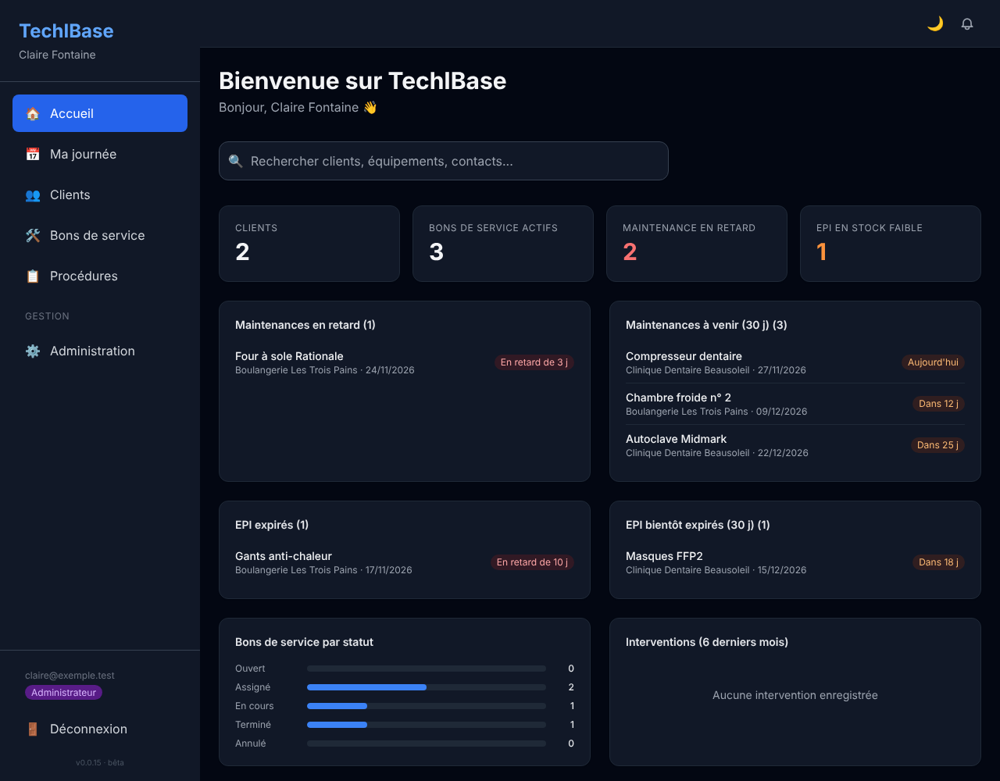

# Mode sombre

TechIBase existe en **thème clair** et en **thème sombre**, plus reposant le soir ou dans un véhicule. Le choix est un simple bouton, sur ordinateur comme sur téléphone.

## Changer de thème

Le bouton se trouve **en haut à droite**, à côté de la cloche des notifications (dans la barre du haut sur ordinateur, dans l'en-tête sur téléphone). Chaque clic passe au thème suivant, dans cet ordre :

| Icône | Thème | Effet |
|---|---|---|
| 🖥️ | **Automatique (système)** | Suit le réglage clair ou sombre de votre appareil, et change tout seul quand celui-ci change (par exemple au coucher du soleil) |
| ☀️ | **Clair** | Toujours clair |
| 🌙 | **Sombre** | Toujours sombre |

En passant la souris sur le bouton, une infobulle indique le thème actuel (« Thème : Sombre. Cliquer pour changer. »).

## Ce qu'il faut savoir

- Le **thème automatique** est le réglage de départ.
- Le choix est mémorisé **dans le navigateur** (de l'appareil que vous utilisez), pas dans votre compte : il faut le refaire sur un autre appareil ou un autre navigateur, et il est perdu si vous videz les données du site. Si le navigateur bloque ce stockage, le choix tient jusqu'au rechargement de la page.
- Les pages ne « clignotent » pas au chargement : le thème est appliqué avant l'affichage de la page.

## Voir aussi

- [Premiers pas](premiers-pas.md) : se repérer dans l'application.
- [Ma journée](ma-journee.md) : la vue téléphone du technicien.
