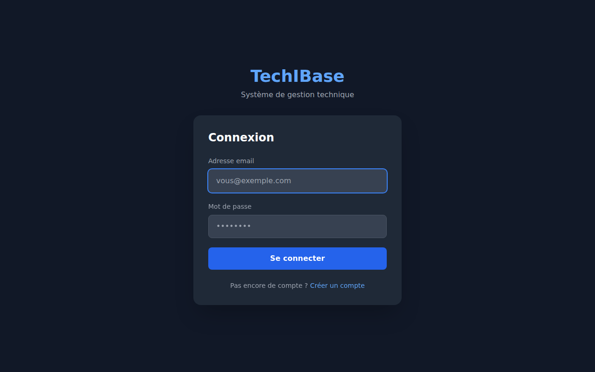
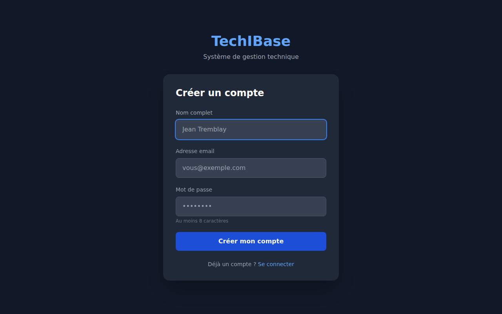
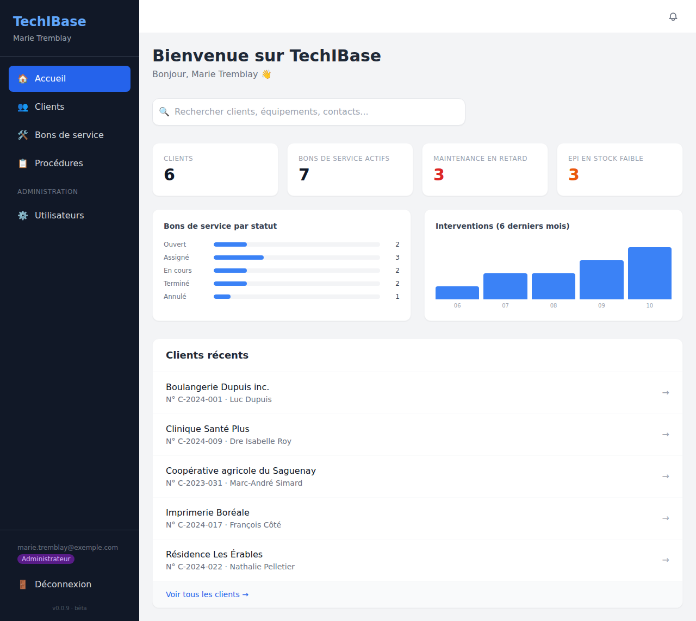
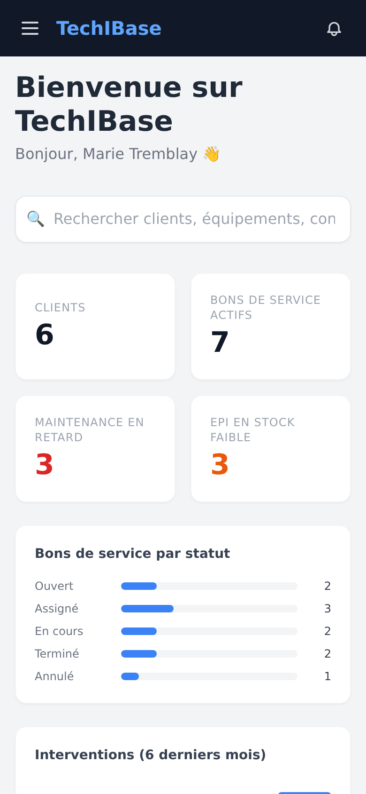
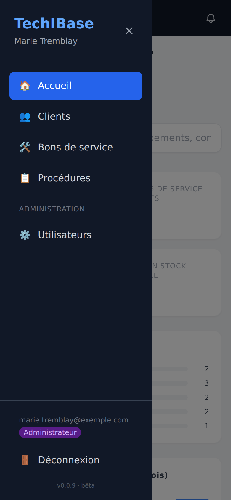

# Premiers pas

## Se connecter

Ouvrez l'adresse de votre TechIBase (par exemple `http://localhost`). Entrez votre courriel et votre mot de passe, puis **Se connecter**.

- Une session dure **8 heures** ; ensuite, l'application vous ramène à l'écran de connexion.
- Si le courriel ou le mot de passe est incorrect, le message « Identifiants invalides » s'affiche et vous restez sur la page.
- Les boutons **Google** et **Microsoft 365** n'apparaissent que si votre administrateur a configuré le SSO (voir [Administration](administration.md)).

## Créer le premier compte

Sur une installation neuve, **aucun compte n'existe**. Cliquez sur **Créer un compte**, remplissez le nom, le courriel et un mot de passe d'au moins 8 caractères.

> **Le tout premier compte créé devient automatiquement administrateur.** Les suivants reçoivent le rôle « Utilisateur ». Créez donc ce premier compte vous-même, tout de suite après l'installation.

L'auto-inscription reste ouverte ensuite : n'importe qui qui connaît l'adresse peut se créer un compte « Utilisateur » et voir les données. Comme TechIBase stocke des identifiants de clients, lisez [Administration](administration.md) avant de l'exposer sur Internet.

## Se repérer

La barre latérale donne accès à tout :

| Entrée | Contenu |
|---|---|
| 🏠 **Accueil** | Tableau de bord et recherche globale |
| 👥 **Clients** | La liste des clients et leur fiche |
| 🛠️ **Bons de service** | Le tableau de toutes les interventions |
| 📋 **Procédures** | Toutes les procédures, tous clients confondus |
| ⚙️ **Utilisateurs** | Gestion des comptes (administrateurs seulement) |

En bas de la barre : votre courriel, votre rôle, **Déconnexion** et le numéro de version. La cloche 🔔 en haut à droite montre vos [notifications](recherche-et-notifications.md).

## Le tableau de bord

| Élément | Signification |
|---|---|
| **Clients** | Nombre de clients. Cliquez pour ouvrir la liste |
| **Bons de service actifs** | Bons ni terminés ni annulés. Cliquez pour ouvrir le tableau |
| **Maintenance en retard** (rouge) | Équipements dont la date de prochaine maintenance est aujourd'hui ou dépassée |
| **EPI en stock faible** (orange) | Équipements de protection dont la quantité est de 2 ou moins |
| **Bons de service par statut** | Répartition Ouvert / Assigné / En cours / Terminé / Annulé |
| **Interventions (6 derniers mois)** | Nombre d'entrées de type « Intervention » du journal, par mois |
| **Clients récents** | Accès rapide aux clients |

## Sur téléphone

L'application s'adapte aux petits écrans : la barre latérale se replie derrière le bouton ☰, et les cartes passent sur deux colonnes.

## Les dates

Les dates sans heure (prochaine maintenance, expiration d'un EPI, échéance d'un bon de service) sont affichées sous la forme **JJ/MM/AAAA**. Dans les formulaires, le sélecteur de date suit la langue de votre navigateur, ce qui peut faire apparaître le mois avant le jour.
