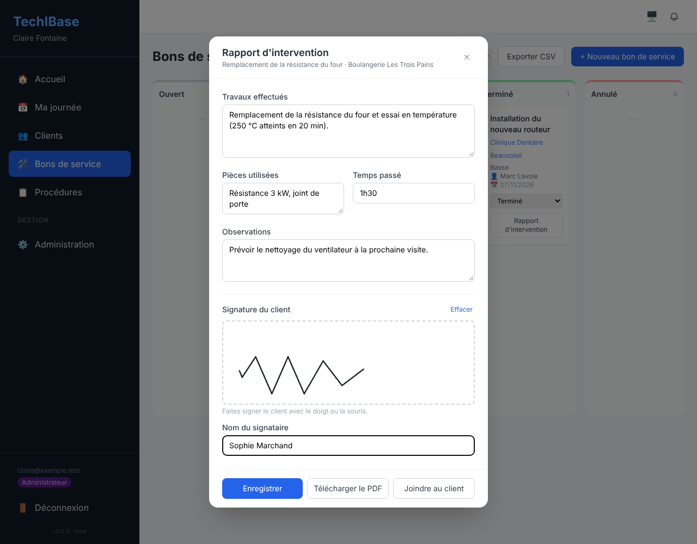

# Rapports d'intervention

À la fin d'une intervention, le technicien rédige un **rapport** depuis le bon de service, le **client le signe à l'écran**, puis TechIBase produit un **PDF** à télécharger ou à joindre aux documents du client.

## Ouvrir le rapport d'un bon

Dans le tableau des [Bons de service](bons-de-service.md), chaque carte porte un bouton **Rapport d'intervention**. Il n'est visible que pour :

- un **administrateur** ;
- le **technicien assigné** au bon ;
- la personne qui a **créé** le bon.

Les autres utilisateurs ne voient pas le bouton, et l'API refuse l'accès (« Accès refusé »). Il y a **un seul rapport par bon** : le rouvrir recharge ce qui a été enregistré.

## Remplir le rapport

| Champ | Contenu |
|---|---|
| **Travaux effectués** | Ce qui a été fait (jusqu'à 10 000 caractères) |
| **Pièces utilisées** | Les pièces posées ou remplacées |
| **Temps passé** | Durée au format libre : `1h30`, `45 min`, `2 h`… Une valeur non reconnue est refusée avec des exemples |
| **Observations** | Remarques, travaux à prévoir |
| **Signature du client** | Zone tactile : le client signe au doigt (ou à la souris sur ordinateur). **Effacer** recommence |
| **Nom du signataire** | Obligatoire dès qu'une signature est tracée |

Sur téléphone, la fenêtre occupe le bas de l'écran ; le tracé se fait directement sur la zone pointillée.

## Les trois boutons

| Bouton | Effet |
|---|---|
| **Enregistrer** | Sauvegarde le rapport. Message « Rapport enregistré et signé. » ou « Rapport enregistré (non signé). » |
| **Télécharger le PDF** | Enregistre d'abord les modifications, puis télécharge `rapport-intervention-N.pdf` |
| **Joindre au client** | Enregistre, puis ajoute le PDF aux **Documents** de la fiche du client. Le rapport doit être **signé** : sinon le message « Le rapport doit être signé avant d'être joint au dossier du client » s'affiche. Joindre de nouveau **remplace** le PDF précédent au lieu d'en empiler une copie |

> **La signature porte sur le contenu.** Si vous modifiez le texte d'un rapport déjà signé et l'enregistrez sans faire resigner le client, la signature est **retirée** (la fenêtre le rappelle : « Signé par … Enregistrer sans nouvelle signature retire cette signature »). Faites signer de nouveau après toute correction.

La signature est une image PNG limitée à **64 Ko** et vérifiée par le serveur ; si le tracé est trop volumineux, effacez et recommencez avec un tracé plus simple.

## Le PDF

Le PDF reprend : l'**en-tête** (le nom de l'entreprise), les informations du **client**, celles du **bon de service**, le **rapport** (travaux, pièces, temps passé, observations), la **signature** avec le nom du signataire, et la **date** de génération.

Le nom de l'entreprise de l'en-tête vient de la variable `COMPANY_NAME` du serveur ; sans elle, l'en-tête est « TechIBase ». Les fichiers Compose fournis avec TechIBase ne transmettent pas cette variable au conteneur : en installation Docker, l'en-tête reste donc « TechIBase » tant que vous ne l'ajoutez pas vous-même à la section `environment` de votre fichier Compose.

La signature du rapport et son ajout au dossier du client sont inscrits au [journal d'audit](journal-d-audit.md) (« Rapport d'intervention signé », « Rapport d'intervention joint au client »).

## Limite sur Netlify

Sur le déploiement **Netlify** (voir le [README du dépôt](../README.md)), la **génération du PDF n'est pas disponible** : le serveur répond 501 et l'application affiche « La génération de PDF n'est pas disponible sur ce déploiement ». La rédaction, la sauvegarde et la signature du rapport y fonctionnent normalement. Sur une installation Docker, rien n'est à activer : le PDF est produit par le serveur lui-même.

## Voir aussi

- [Bons de service](bons-de-service.md) : le tableau où se trouve le bouton.
- [Ma journée](ma-journee.md) : terminer le bon avant de faire signer le client.
- [La fiche client](fiche-client.md) : l'onglet Documents où le PDF est joint.
