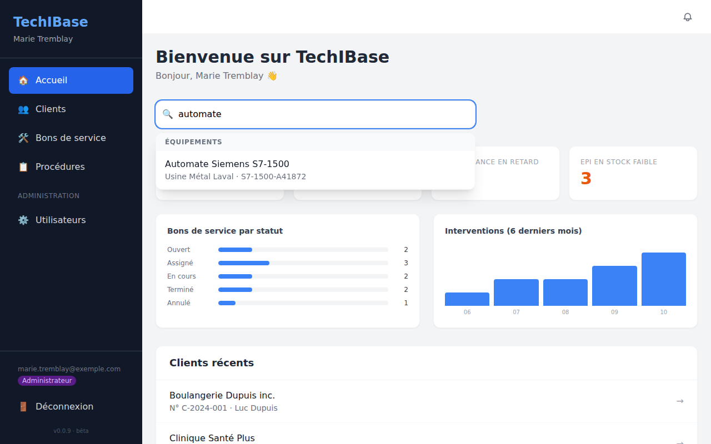
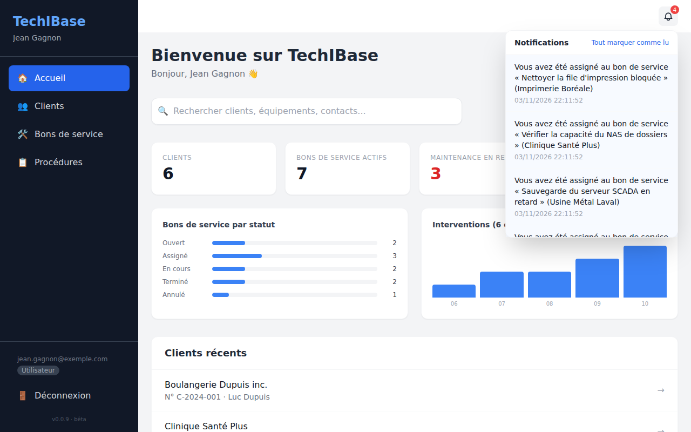

# Recherche et notifications

## La recherche globale

Le champ de recherche de la page **Accueil** cherche en même temps dans trois familles de données (jusqu'à 10 résultats chacune) :

| Famille | Champs cherchés |
|---|---|
| **Clients** | nom, numéro de contrat, responsable |
| **Équipements** | nom, numéro de série, type |
| **Contacts** | nom, courriel, téléphone |

Cliquez sur un résultat pour ouvrir la fiche du client concerné. La recherche ignore la casse, mais **pas les accents** : « chaudiere » ne trouve pas « Chaudière ».

Dans la liste **Clients**, un second champ filtre les clients par nom, contrat ou responsable.

## Les notifications dans l'application

La cloche 🔔, en haut à droite, affiche le **nombre de notifications non lues** et, au clic, la liste.

- Un technicien est notifié dès qu'un **bon de service lui est assigné** : « Vous avez été assigné au bon de service « … » (client) ».
- **Tout marquer comme lu** vide le compteur.
- Le compteur se rafraîchit toutes les 60 secondes.

## Les courriels (facultatif)

Si la variable `RESEND_API_KEY` est définie dans le `.env` (voir [Administration](administration.md)), TechIBase envoie aussi :

- un **courriel d'assignation** au technicien, en plus de la notification ;
- un **résumé quotidien aux administrateurs** : équipements dont la maintenance est en retard et EPI en stock faible (2 ou moins).

Sans cette variable, tout fonctionne ; il n'y a simplement pas de courriel.
